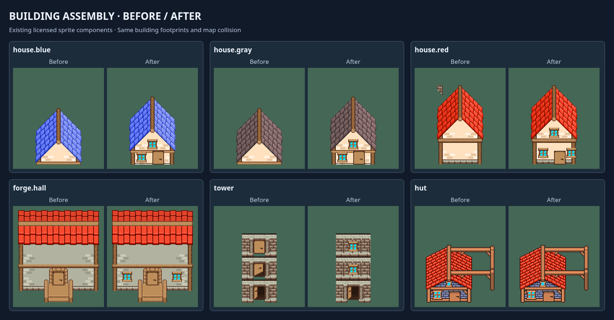

# Building assembly review

The houses used unfinished modular roof pieces as complete buildings. The
forge facade had little detail, and the tower crop stacked three alternate
door tiles vertically. The red house also picked up a neighboring chimney
fragment from its atlas rectangle.

This pass assembles the existing licensed pieces into finished facades:
windows, attic windows, doors, wall courses and foundations. It adds forge
windows, gives the tower upper windows and one ground
entrance, and removes the stray chimney fragment. Mossvale's bakery now uses
the taller red house so the opening row has more than roof-color variation.

The building footprints, collision maps, authored door positions, NPC tasks
and progression remain unchanged. Decorative details share their building's
depth and its transparency when the player walks behind it.

Validation: coordinator visual inspection of the six building comparisons
and phone/desktop hometown views; source rectangles checked against their
actual PNG bounds; assembled doors checked against authored walk-up doors;
format, lint, types, 1,610 tests and the production build passed. All four
actual hero selections and openings passed on desktop and phone layouts.
This is a coordinator review, not independent art-director approval.

This repairs unfinished assembly. It does not complete the broader need for
different building silhouettes, civic landmarks and distinctive architecture
in each settlement. The mushroom houses and mountain hut retain their
existing complete sprites.

The attempted anvil facade marker was removed after player review: using a
full anvil sprite as signage made it look like equipment protruding through
the wall. The map's separate outdoor anvil remains in its intended place.
