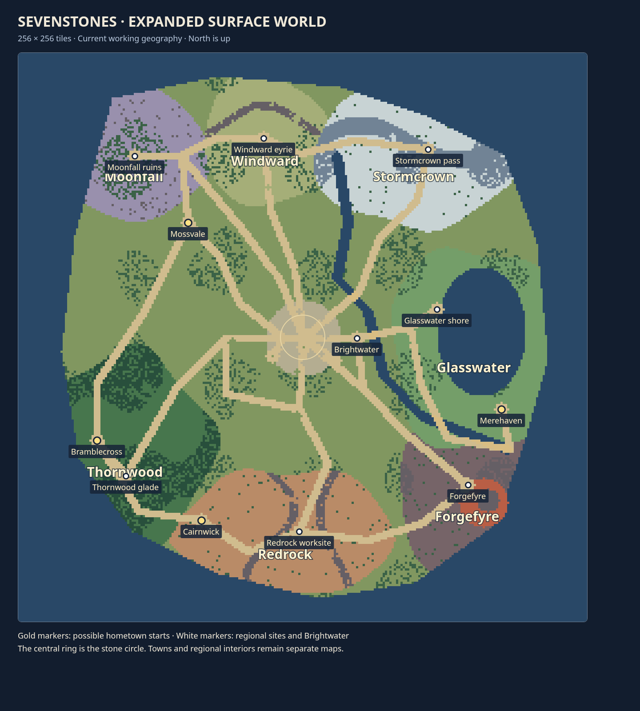

# Expanded overworld review

Sevenstones was a 40 × 24 junction connecting small regional maps. It is now
a 256 × 256 surface world with distinct provinces, a central stone circle,
branched roads, river crossings and separated hometown starts. The existing
regional maps are local sites reached through those provinces.

The image uses the playable world's geography. It shows all four possible
hometown starts; an individual adventure exposes its selected alternate home
without duplicating the opening cast. Town names follow the accepted Mossvale,
Cairnwick, Merehaven and Bramblecross naming.

This review is the coordinator's verification, not independent expert approval.

- Physical route tests cover all four homes and seven provinces. Each home
  has a substantial route to the central circle without a mandatory regional
  monster fight. Regional teacher homes and approach challenges stay intact.
- Northern approaches retain earned road keys and the Stormcrown → Windward
  → Moonfall sequence. Existing journeys retain historical access without
  fabricated visits. School-first travel catches up one vision per crossing.
- Full-campaign transition tests still cover the underground route, its
  tasks and boss sequence through the final battle. Underground exits return
  to their corresponding new surface landings.
- Version-16 world positions and respawns migrate around their landmarks once;
  hometown choices, inventory, spells and story flags persist. Current saves
  cannot gain road keys just by reloading a Cave Pass.
- Real App browser checks cover each hero on desktop and phone layouts,
  selecting destinations and reading closed-route hints, closing the map,
  keyboard/touch walking and saved-position reload. See the
  [browser report](artifacts/SURFACE_BROWSER_REPORT.json).
- The renderer culls offscreen props and terrain. Timings are Chromium render
  calls in the test environment, not physical Safari or native iPhone results.
- Format, lint, types, 1,631 tests and the production build passed, with 25
  existing optional skips. The existing desktop/touch casting smoke passed.

Human review of exploration density and travel pacing remains necessary.
In particular, larger geometry does not establish the Moon Wyrm's midpoint
in elapsed playtime. Further building silhouettes and settlement character
also remain art-direction work. The installed native app is still the
separate Slime controls prototype; this change does not claim a native
campaign port.

Implementation scope: [overworld expansion](../OVERWORLD_EXPANSION.md).
